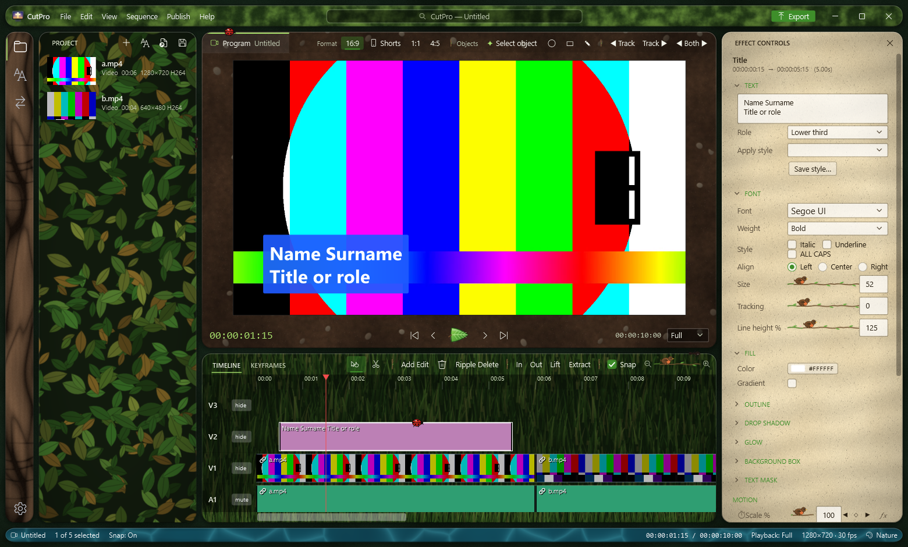

# CutPro

A Premiere Pro–style video editor for Windows, built with WPF and .NET 9. Preview and export use ffmpeg, and every effect is checked against the export by automated preview-vs-export tests.



## Features

- **Editing:** up to 32 video + 32 audio tracks per sequence (named, lockable, resizable), select / razor / ripple / rolling / rate stretch / slip / slide tools, lift / extract, linking, snapping, multiple and nested sequences, a source monitor with Insert / Overwrite and Match Frame, sample-accurate audio edits, markers with MP4 / YouTube chapters, copy / paste and Paste Attributes, clip groups, split-screen and picture-in-picture layouts, relink and Collect Files.
- **Playback:** an audio-clock player with hardware decoding (chosen per file by measurement), a scrub cache, J / K / L shuttle (2×, 4×, 8×, backwards), audio scrubbing and proxies.
- **Picture:** motion with keyframes and formulas, blend modes, crop / flip, chroma and luma keys, track mattes, corner pin, lens distortion, twirl / wave / spherize / mesh warp, adjustment layers, Lumetri-style colour (wheels, curves, .cube LUTs, HSL secondary, power windows) with scopes, cartoon / anime looks, transitions, speed / reverse / time remapping with frame blending or optical flow, stabilization, noise reduction, opacity rubber bands, clips that follow a tracked object, generated colour mattes / gradients / bars and tone / counting leaders.
- **Titles and captions:** styled titles with themes, text masks and text animation (typewriter, by letter / word / line, rolling and crawling credits), and captions from speech (Whisper) with SRT / VTT.
- **Smart tools:** text-based editing (delete words in the transcript), scene edit detection, synchronize clips by their sound, beat detection and cut to the beat, auto-ducking, colour match, background removal, auto reframe with push-in, effect presets.
- **AI object masks:** click to select with MobileSAM, then track; blur, pixelate, colour pop and more.
- **Audio:** track mixer with automation, submixes, clip and track effects (EQ, compressor, gate, de-esser, reverb), pitch shift, noise reduction / voice isolation, channel mapping, BS.1770 loudness normalization, mono and 5.1 exports.
- **Export:** platform presets (YouTube, Shorts, TikTok, Instagram, …), H.264 / HEVC / AV1 / VP9 / ProRes (including 4444), transparent exports (ProRes 4444, VP9, QuickTime Animation, PNG sequence), GPU encoders, a full-colour 4:4:4 composite, a background render queue.
- **Publishing:** uploads to the major platforms with your own developer app credentials; caption / hashtag suggestions; thumbnail and intro studios.
- **Project:** bins with colour labels, ratings, keywords and search; auto-save with versions and crash recovery; voice-over recording; upscaled copies; EDL and OpenTimelineIO export; import of OpenTimelineIO, Premiere / Final Cut 7 XML and EDL.
- **Interface:** dockable panels and workspaces, a History panel, a command palette, editable keyboard shortcuts (Premiere defaults), English / German / Spanish / French, a larger-interface option, and flat and material themes.

## Requirements

- Windows 10 / 11
- [.NET 9 SDK](https://dotnet.microsoft.com/download)
- ffmpeg + ffprobe 7 or newer on the PATH (for example `winget install Gyan.FFmpeg`)

The AI models (MobileSAM, Whisper base, CLIP B/32) are not in the repository. CutPro offers to download them the first time a feature needs one.

## Build and run

```bash
dotnet run -c Release --project CutPro
```

Tests (build, self test, export, formats; `-play` adds the playback measurements):

```bash
powershell -NoProfile -ExecutionPolicy Bypass -File ./test.ps1 -play
```

`Agent.md` describes the architecture, the design rules and every test command; `ROADMAP.md` lists what's planned and `PROGRESS.md` what was done when.
